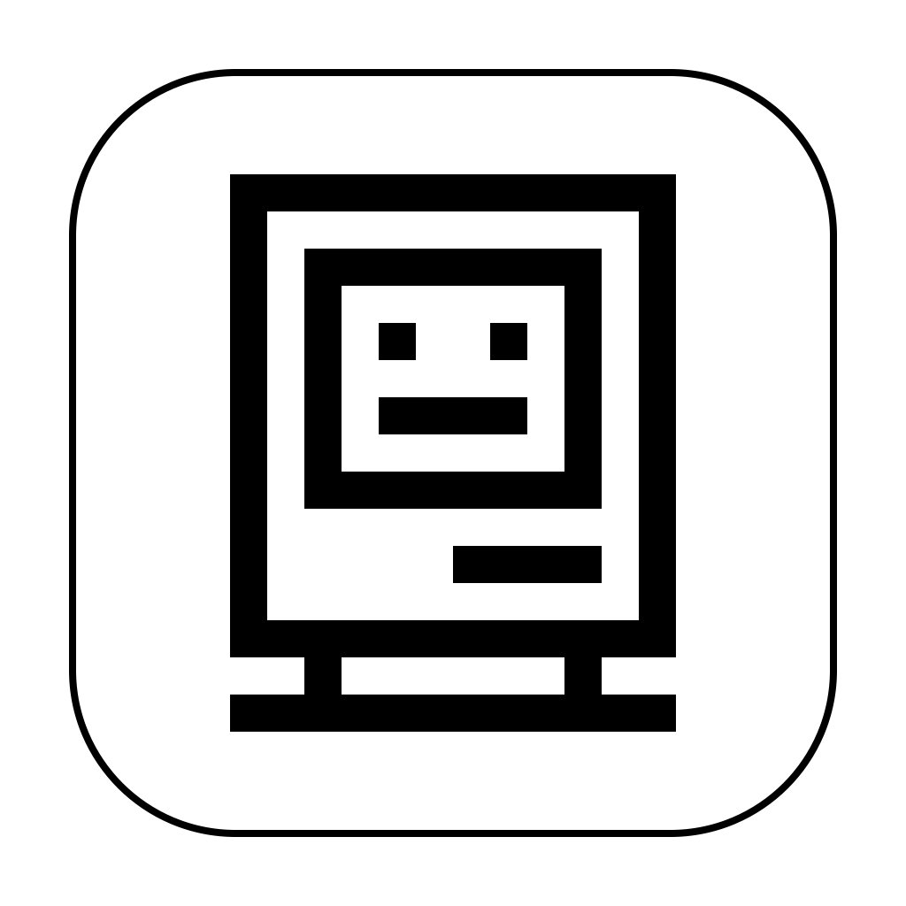
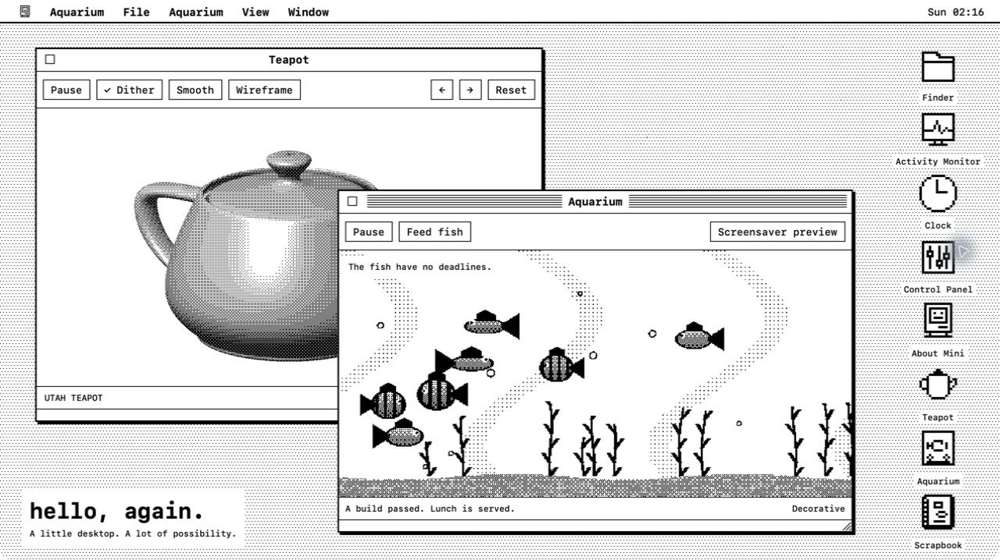

# Hello Mini



A Macintosh-inspired desktop for modern Macs: useful desk accessories, vintage interfaces, and a deeply unreasonable amount of fish.

**Apple silicon · macOS 26+ · MIT licensed**

[Website](https://hellomini.app) · [Download](https://github.com/emmettl/hellomini/releases/latest) · [User guide](docs/USER_GUIDE.md)



Hello Mini combines file browsing, local system monitoring, network discovery and checks, clocks, a calculator, a searchable Scrapbook, and a small monochrome painting app. Print Monitor turns GitHub Actions and GitLab builds into imaginary print jobs: failures jam the printer, and successful builds can feed the Aquarium.

Six themes span monochrome Macintosh styling, System 7, Platinum and early Aqua. Windows remember their arrangement; desktop presets, enlarged interface modes and a fixed 512 × 384 Purist mode let you arrange your miniature workspace. Optional diversions include a Metal teapot, live-desktop puzzle, Talking Moose and Flying Toasters. Effects respect Reduce Motion and their visibility controls.

## Install

```sh
brew install --cask emmettl/tap/hellomini
```

Or download the signed, Apple-notarized ZIP from [GitHub Releases](https://github.com/emmettl/hellomini/releases/latest), expand it and move **Hello Mini.app** to Applications. See [installation and updates](docs/INSTALL.md) for requirements, upgrades and saved data.

## Develop

Built with SwiftUI, AppKit and Metal, using SwiftPM modules. Source development requires Xcode 27 / Swift 6.4 on macOS 26.6 or later; the released app runs on macOS 26+.

```sh
make run     # Build and launch a local app
make check   # Lint, test and build
```

[Contributing](CONTRIBUTING.md) · [Architecture](docs/ARCHITECTURE.md) · [Roadmap](ROADMAP.md) · [Changelog](CHANGELOG.md) · [CI](docs/CI.md) · [Releasing](docs/RELEASING.md)

Hello Mini is an independent homage, unaffiliated with Apple or the creators of After Dark. It is [MIT licensed](LICENSE); imported assets retain their [third-party notices](THIRD_PARTY_NOTICES.md).
